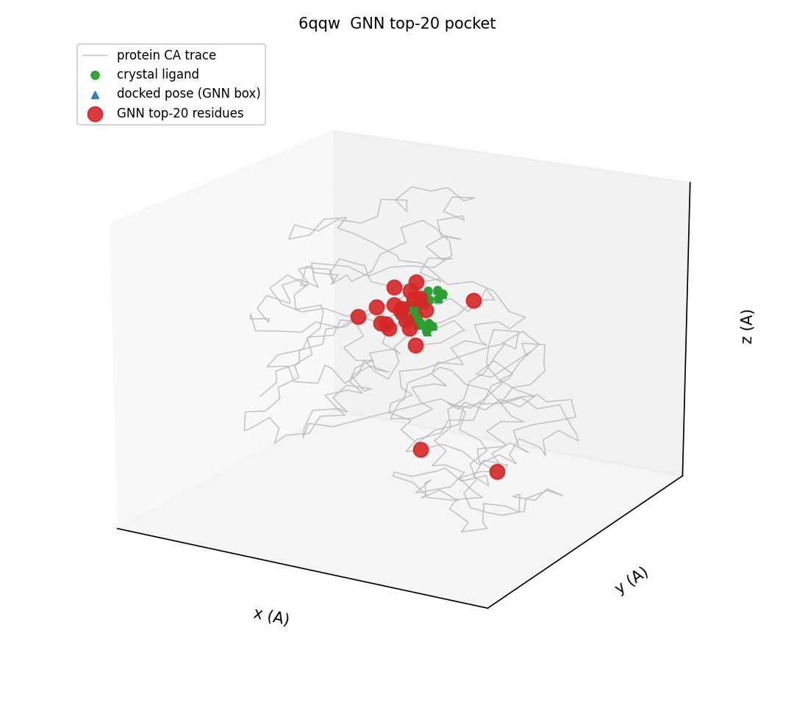
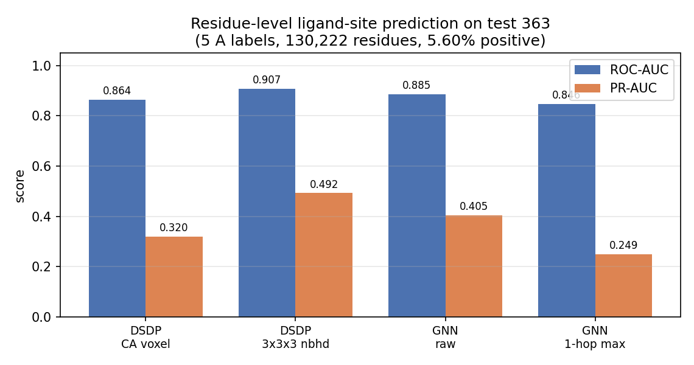
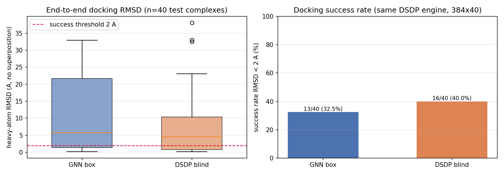
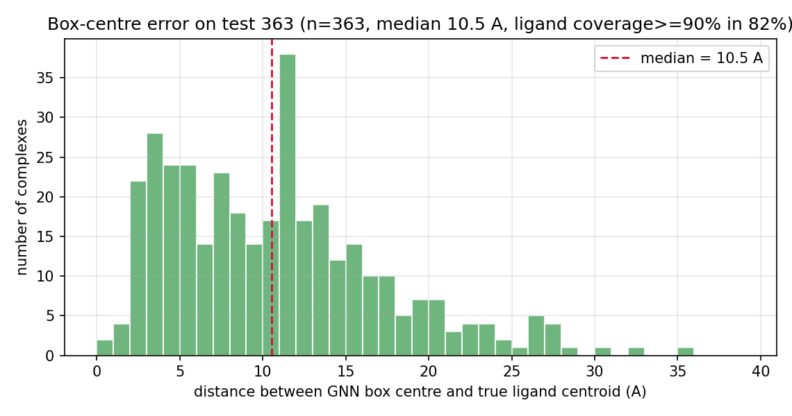

# GNN-DSDP：残基级 GNN 位点预测 + DSDP 对接（Residue-level GNN binding-site prediction + DSDP docking）


**Replace DSDP's 3D-CNN (voxel) binding-site model with a residue-level GCN**, turn the
per-residue probabilities into a docking box, and hand the box back to DSDP's CUDA docking
engine — then compare both pipelines on the PDBBind v2020 time split.

> 组内 demo 级别实现：优先"跑通 + 可复现 + 结论诚实"，不追求 SOTA。
> 代码与数据**都不含** PDBBind 原始结构（许可禁止再分发），拿到数据后按 §4 准备即可。



| 关键数字 | 值 |
|---|---|
| 模型规模 | 4 层 GCN，**3,570 参数** |
| test 363（残基级） | ROC-AUC **0.8853** / PR-AUC **0.4049**（随机 PR≈0.056） |
| val 968（选模型用） | ROC-AUC **0.9147** / PR-AUC **0.4452** |
| 端到端对接（n=40） | GNN 盒子 **32.5%** RMSD<2 Å vs DSDP 原版 **40.0%** |
| 盒子覆盖率（test 363） | 平均 **0.889**，82.1% 复合物覆盖 ≥90% 配体 |

**Table of contents** · [1 快速开始](#1-快速开始) · [2 结果](#2-结果) · [3 方法](#3-方法) ·
[4 数据](#4-数据准备) · [5 环境变量](#5-环境变量) · [6 复现步骤](#6-完整复现步骤) ·
[7 仓库结构](#7-仓库结构) · [8 常见问题](#8-常见问题troubleshooting) · [9 局限](#9-局限) ·
[10 引用](#10-引用与许可)

### 仓库里有什么 / 没有什么

| 包含 ✅ | 不包含 ❌ |
|---|---|
| 全部代码（`scripts/` 20 个脚本）与 slurm 模板 | **任何结构/图数据**（PDBBind 许可禁止再分发） |
| 训练好的模型 `best_model.pt`（55 KB，3,570 参数） | 中间产物（`data/graph` 约 4.1 GB、`c2_site/`） |
| 结果表/图/日志（`results/` `reports/` `runs/`） | DSDP 的源码与二进制（需另装，见 §4.3） |
| 9 篇阶段报告（`docs/`） | 任何人的集群绝对路径（已改为 `scripts/paths.py` + 环境变量） |

**能不能 clone 就跑？** 模型推理可以（§1.1，只需要 Python 环境）；完整复现需要 §4 的三样外部资源。

**验证状态**：代码与数字均来自同一台集群的实际运行，**未在第二台机器上做端到端验证**。
第一次在新机器上跑，先执行 `python scripts/paths.py`，它会告诉你哪个路径不存在。

---

## 1. 快速开始

### 1.1 只跑模型：给你的蛋白打分（环境就绪后 <1 分钟，**不需要任何数据集**）

仓库里带了训练好的 `best_model.pt`（从仓库根自动加载），只要有 Python 环境就能用：

```bash
git clone <this-repo> && cd gnn-dsdp
conda create -n gnn-dsdp python=3.9 -y && conda activate gnn-dsdp
pip install -r requirements.txt
conda install -c conda-forge dssp -y          # 提供 mkdssp（DSSP 二级结构）

# 任意蛋白 PDB 都行（不需要 PDBBind）
python scripts/predict.py --protein my_protein.pdb --out pred.csv
head -3 pred.csv
```

输出（按概率降序，真实示例为 `6qqw`，411 个残基）：

```
rank,chain,resseq,icode,resname,ca_x,ca_y,ca_z,prob
1,A,85,,PRO,-18.944,17.743,-8.653,0.968880
2,A,86,,ALA,...
[predict] prob: min=0.0000 max=0.9689 mean=0.2408  n>0.5=76
```

再做"残基 → 对接盒子"（36 Å 立方，阈值 0.5；参数在 val 968 上选定）：

```bash
python scripts/residue_to_box.py --protein my_protein.pdb --json box.json
```

`6qqw` 上的真实输出：

```
[box] 6qqw (411 residues) model epoch=92
[box] selection=threshold n_selected=76 clusters=3 main=41
[box] box_size=36 centre=weighted -> box_min=[-37.635,-2.097,-26.046] box_max=[-1.635,33.903,9.954]
```

> `--protein` 既接受 `*.pdb` 路径，也接受 4 位 PDB id（后者需要 §4.1 的结构索引）。

### 1.2 完整跑一遍（需要 PDBBind + DSDP）

按 §4 准备三样外部资源（PDBBind 结构、EquiBind 切分编号、DSDP 仓库），
然后照 §6 的 9 条命令逐条执行，或在仓库根目录：

```bash
python scripts/paths.py    # 先看缺什么
```

---

## 2. 结果

### 2.1 残基级位点预测（test 363，5 Å 标签，130,222 残基 / 5.60% 正样本）

| 方法 | 口径 | ROC-AUC | PR-AUC |
|---|---|---|---|
| DSDP 3D-CNN | Cα 所在体素 | 0.8636 | 0.3204 |
| DSDP 3D-CNN | 3×3×3 邻域最大 | **0.9075** | **0.4925** |
| **GNN（full 16,379）** | 原始概率 | 0.8853 | 0.4049 |
| GNN | 1-hop 图邻域最大 | 0.8464 | 0.2487 |



CSV：`results/table_residue_test363.csv`

### 2.2 端到端对接成功率（test 363 分层抽 40 个，同一 DSDP 引擎）

设置：`exhaustiveness 384 / search_depth 40 / top_n 1`，RMSD 用重原子、不叠合、<2 Å 记成功。

| 管线 | n | 成功率 | RMSD 中位 | 盒子覆盖率 | 失败（没罩住 / 罩住没采到） |
|---|---|---|---|---|---|
| GNN 盒子（阈值 0.5 / 36 Å） | 40 | **13/40 = 32.5%** | 5.72 Å | 0.855 | 6 / 21 |
| DSDP 原版 blind docking | 40 | **16/40 = 40.0%** | 4.58 Å | 0.900 | 4 / 20 |



CSV：`results/table_e2e.csv`、`runs/e2e_benchmark.csv`

### 2.3 盒子质量与其它考场

| 指标 | 值 |
|---|---|
| 盒子中心误差（test 363） | 中位 **10.5 Å** / 平均 11.5 Å |
| 覆盖 ≥90% 配体的复合物 | **82.1%** |
| DUD-E 102（补充，不进主表） | PR-AUC **0.5326** / ROC-AUC **0.9141** |



---

## 3. 方法

1. **图**：节点 = 残基；边 = 两残基 Cα 距离 ≤ 10 Å；边权重 = 1/d²。
2. **节点特征（46 维）**：氨基酸 one-hot 20 + 序列前后邻居 2 + DSSP 二级结构 7 + 主链氢键 8
   + 二面角（φ/ψ/τ/θ）4 + 主链/侧链 SASA 2 + 到蛋白质心欧氏/余弦距离 2 + 节点度 1。
   （晶体结构没有 pLDDT，故该维省略；`features.py --with-plddt` 可补恒 1.0 的第 47 维。）
3. **模型**：`46 → 38 → 28 → 18 → 8 → 2`，ELU + log_softmax，**3,570 参数**。
4. **标签**：残基重原子与配体重原子最小距离 **≤ 5 Å** 为正样本
   （train 4.30% / val 4.01% / test 5.60% 正样本，故主指标用 PR-AUC）。
5. **损失**：`NLLLoss(weight=[1, neg/pos≈22])`。
6. **残基 → 盒子**：概率 ≥ 0.5 → Cα 单链接聚类（≤8 Å）→ 取最大簇 → 概率加权质心 →
   **36 Å 立方**。阈值/边长/半径**全部在 val 968 上选定**，test 只做一次性报告。
7. **对接**：`DSDP_redocking/DSDP --box_min/--box_max`（不重编译、不修改 DSDP）。

---

## 4. 数据准备

> 本仓库**不含任何结构/图数据**。以下三样都是公开资源，PDBBind 需要注册（学术免费）。

### 4.1 PDBBind v2020（约 10 GB）

- 来源：<https://www.pdbbind-plus.org.cn/> → `Download Data Packages` → **PDBBind v2020**
- 需要两个 protein-ligand 包 + index，合计 **19,443** 个复合物：
  - `general set minus refined set`（1.8 GB，14,127）
  - `refined set`（658 MB，5,316）
  - `Index files of PDBbind`（3 MB）
- 解包到 `$PDBBIND_DIR`（默认 `./pdbbind_v2020/`），结构应为
  `refined-set/<id>/<id>_protein.pdb|_ligand.mol2|_ligand.sdf|_pocket.pdb` 与 `v2020-other-PL/<id>/…`
- 验证：`python scripts/collect_structures.py` 打印 5,316 + 14,127 = 19,443 并核对覆盖率
- ⚠️ 许可是**禁止再分发**，不要提交到仓库（`.gitignore` 已挡住）

### 4.2 EquiBind time-split 编号（三个文本文件）

- 来源：<https://github.com/HannesStark/EquiBind> 的 `data/` 目录
  （原 Zenodo 打包数据已因版权下架，README 指引就是"自己去 PDBBind 下"）
- 文件名（保持原样，放进 `$SPLIT_DIR`，默认 `./splits/`）：
  `timesplit_no_lig_overlap_train`（16,379 行）、`timesplit_no_lig_overlap_val`（968）、
  **`timesplit_test`**（363，注意没有 `no_lig_overlap` 前缀）
- 验证：`python scripts/paths.py` 打印三个文件行数

### 4.3 DSDP 仓库（对接引擎 + 测试集 pdbqt）

```bash
git clone https://github.com/PKUGaoGroup/DSDP.git DSDP
cd DSDP && git sparse-checkout add test_dataset   # 测试集默认被 sparse-checkout 排除
# 按 DSDP 自己的 README 编译 DSDP_redocking / DSDP_blind_docking / surface_tool / protein_feature_tool
```

- 默认放在与本仓库同级的 `../DSDP`；其它位置用 `export DSDP_HOME=...`
- 用到的内容：`test_dataset/PDBBind_time_split_dataset`（363，主考场）、
  `test_dataset/DUD_E_dataset`（102）、`test_dataset/DSDP_dataset/1a2b`（冒烟）、
  两个 GPU 二进制、`binding_site_model.pth`（基线）
- 验证：`python scripts/paths.py` 中 `DSDP_HOME` / `TEST_PDBBIND_DIR` / `REDOCK_BIN` 均为 `YES`

---

## 5. 环境变量

全部可选，不设就用默认值（相对仓库自身）：

| 变量 | 默认 | 说明 |
|---|---|---|
| `GNNSITE_HOME` | 仓库根 | 代码与生成数据的根目录 |
| `DSDP_HOME` | `../DSDP` | DSDP 仓库根 |
| `PDBBIND_DIR` | `$GNNSITE_HOME/pdbbind_v2020` | PDBBind 解包目录 |
| `SPLIT_DIR` | `$GNNSITE_HOME/splits` | 三个切分文件目录 |
| `MKDSSP` | 从 PATH 找 | mkdssp 可执行文件 |
| `REDOCK_BIN` / `BLIND_BIN` | `$DSDP_HOME/...` | 两个 DSDP 二进制 |
| `GNNSITE_STRICT` | 空 | 设为 1 时，缺 mkdssp/freesasa 直接报错而不是降级 |

环境要求：Python 3.9、PyTorch + PyTorch Geometric（见 `requirements.txt`）、
`mkdssp`（conda-forge `dssp`）、`freesasa`。**训练/对接需要 GPU**；登录节点通常没有 GPU，
DSDP 的 CUDA 二进制会 `Segmentation fault`，请用 `slurm/*.sbatch` 提交。

---

## 6. 完整复现步骤

全部在仓库根目录执行（预计总量：数据构建约 45 min，训练约 12 min，磁盘约 15 GB）：

```bash
python scripts/paths.py                                  # 0. 自检

python scripts/collect_structures.py                     # 1. 结构索引（秒级）

python scripts/build_dataset.py --split test             # 2. 5 Å 残基标签
python scripts/build_dataset.py --split val
python scripts/build_dataset.py --split train            #    train 约 21 min

python scripts/graph.py --batch --split test  --workers 16   # 3. 特征 + 建图
python scripts/graph.py --batch --split val   --workers 16
python scripts/graph.py --batch --split train --workers 16   #    train 约 19 min

sbatch slurm/train_full.sbatch                           # 4. 训练（GPU，100 epoch ≈ 12 min）
#   等价：python scripts/train_full.py --device cuda --epochs 100 --batch-size 32 --patience 15

python scripts/evaluate_model.py --model best_model.pt --device cpu   # 5. val/test 指标 + 阈值表

python scripts/predict.py --protein 6qqw --out predict_6qqw.csv      # 6. 单蛋白概率表

python scripts/residue_to_box.py --protein 6qqw \                     # 7. 残基 → 盒子
    --ligand "$DSDP_HOME/test_dataset/PDBBind_time_split_dataset/6qqw/6qqw_ligand.pdbqt"

sbatch slurm/baseline_dsdp_cnn.sbatch                    # 8a. DSDP 3D-CNN 基线（test 363）
sbatch slurm/run_docking_examples.sbatch                 # 8b. 端到端 3 个例子（1a2b/6qqw/6qxa）
sbatch slurm/benchmark_end2end.sbatch                    # 8c. 40 蛋白两条管线对比

python scripts/make_figures.py                           # 9. 表与图 → results/
python scripts/make_pocket_views.py --ids 6g2o,6jao,6qqw,6kqi,5zk7
```

产物约定：`data/label/`、`data/graph/`（中间数据）、`reports/`（日志/阈值表/统计）、
`results/`（表与图）、`runs/`（对接输出与逐条结果）。

---

## 7. 仓库结构

```
gnn-dsdp/
├── README.md  LICENSE  requirements.txt  .gitignore  best_model.pt
├── scripts/    20 个 Python 脚本（paths.py 为统一路径配置）
├── slurm/       7 个 slurm 作业模板
├── docs/        9 篇阶段报告（环境盘点 / 基线 / 特征 / 训练 / 盒子 / 端到端 / PPT 要点）
├── results/     两张主表 CSV + 4 张图 + 5 个蛋白可视化（png + pml）
├── reports/     训练日志 json、阈值表、盒子参数扫描、数据统计
└── runs/        端到端逐条结果与样例 pose（pdbqt）
```

| 脚本 | 作用 |
|---|---|
| `scripts/paths.py` | **唯一路径配置**，`python scripts/paths.py` 自检 |
| `scripts/collect_structures.py` | 扫 PDBBind 建结构索引、核对切分覆盖率 |
| `scripts/build_dataset.py` | 5 Å 残基标签 |
| `scripts/features.py` / `graph.py` | 46 维特征 / 建图（PyG `Data`） |
| `scripts/model.py` / `train_full.py` / `train_smoke.py` | 模型 / 正式训练 / 冒烟训练 |
| `scripts/predict.py` / `residue_to_box.py` / `run_gnn_dsdp.py` | 概率表 / 盒子 / 端到端对接 |
| `scripts/baseline_dsdp_cnn.py` | DSDP 3D-CNN 基线（体素→残基投影） |
| `scripts/evaluate_model.py` / `analyze_box_coverage.py` / `scan_box_params.py` | 评估 / 盒子覆盖 / 参数扫描 |
| `scripts/benchmark_end2end.py` / `analyze_dsdp_boxes.py` / `evaluate_dude.py` | 端到端对比 / DSDP 盒子复算 / DUD-E |
| `scripts/make_figures.py` / `make_pocket_views.py` | 表与图 / 口袋可视化 |

---

## 8. 常见问题（Troubleshooting）

| 现象 | 原因 | 处理 |
|---|---|---|
| `mkdssp ... FileNotFoundError`，或预测结果明显变差 | 缺 `mkdssp`，DSSP 15 维被静默填 0 | `conda install -c conda-forge dssp`，或 `export MKDSSP=...`；`GNNSITE_STRICT=1` 让它硬报错 |
| `import freesasa` 失败 | 源码包编译失败 | `conda install -c conda-forge freesasa` |
| DSDP 二进制在登录节点 `Segmentation fault` | 登录节点无 GPU | 用 `sbatch slurm/*.sbatch` 提交 |
| DSDP 把 `site/`、`out/` 当复合物 | `--dataset_path` 下每个子目录都会被当成复合物 | 输出目录放到 `dataset_path` 之外 |
| `python scripts/paths.py` 显示 `SPLIT_DIR NO` | 切分文件名不对 | 注意 test 文件叫 `timesplit_test`，不带 `no_lig_overlap` |
| GPU 排队很久 | 集群 GPU 常被占满 | `sinfo` 看空闲分区后提交；CPU 也能跑（慢） |
| `torch` 与 CUDA 版本不匹配 | `requirements.txt` 是 cu128 组合 | 按 pytorch.org 换对应 wheel |

---

## 9. 局限

1. **没有超过 DSDP 基线**：3×3×3 邻域口径下 DSDP 更强（PR 0.4925 vs 0.4049），端到端也更强
   （40.0% vs 32.5%，n=40，样本小、无显著性检验）。本项目的贡献是"换成 GNN 并跑通"，不宣称更好。
2. **盒子精度有限**：中心误差中位 10.5 Å，36 Å 盒子只保证 82.1% 复合物覆盖 ≥90% 配体。
3. **概率未校准**：val 平均预测 0.23 而真实正样本 4.01%（`pos_weight≈22` 副作用），
   阈值是排序阈值，不是置信度。
4. **失败模式**：40 个里 6 个盒子完全没罩住配体（如 6kqi、5zk7、6qxa）；DSDP 在部分蛋白上能救回。
5. **模型很小**：3,570 参数 / 46 维手工特征，无 PLM 嵌入、无 EGNN。
6. **DUD-E 102** 与 test 363 不同源（正样本 7.1%），只作补充列。
7. **RMSD 口径**：重原子、不叠合、未做对称原子校正，长链配体可能偏严。

后续可尝试：更强特征（PLM/EGNN）、把"选哪个口袋"当独立分类任务、用 RMSD 而非 AUC 做模型选择。

---

## 10. 引用与许可

- **License**：MIT（见 `LICENSE`）。代码可自由使用；**数据不在本仓库内**，请遵守各自许可
  （PDBBind 禁止再分发；`best_model.pt` 由 PDBBind v2020 训练，仅限学术研究）。
- **依赖的上游项目**（请按各自仓库的说明引用）：
  - DSDP — Gao Group, Peking University：<https://github.com/PKUGaoGroup/DSDP>
  - EquiBind（time-split 编号与对比设定）：<https://github.com/HannesStark/EquiBind>
  - NodeCoder（模型/特征设计参考）：<https://github.com/NasimAbdollahi/Nodecoder>
- PDBBind 数据：<https://www.pdbbind-plus.org.cn/>
